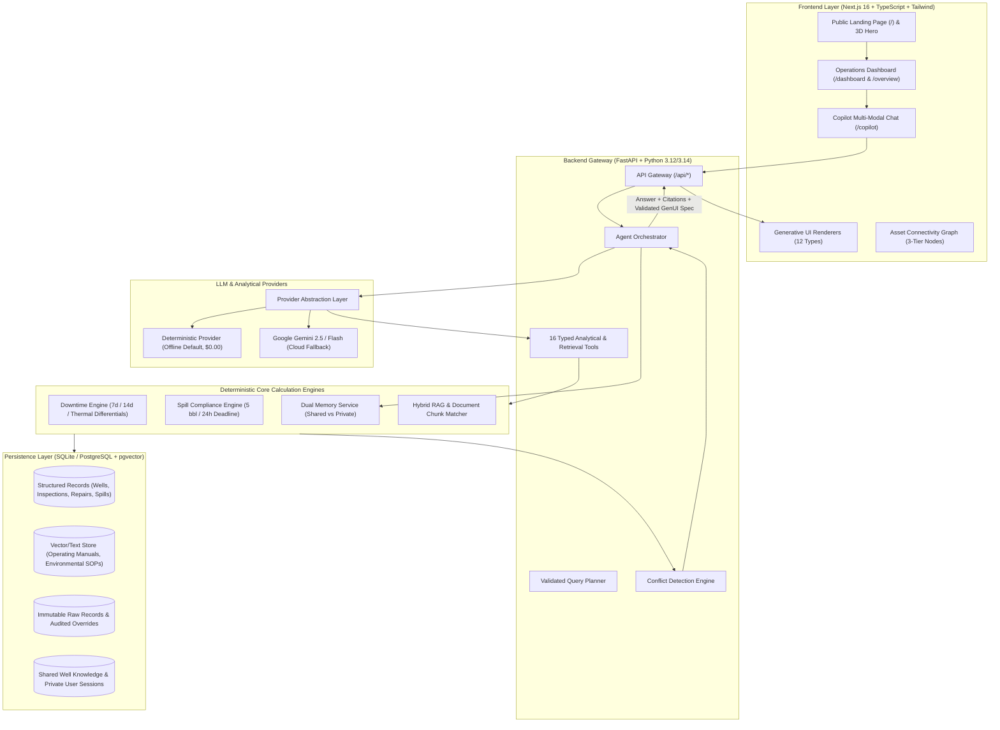
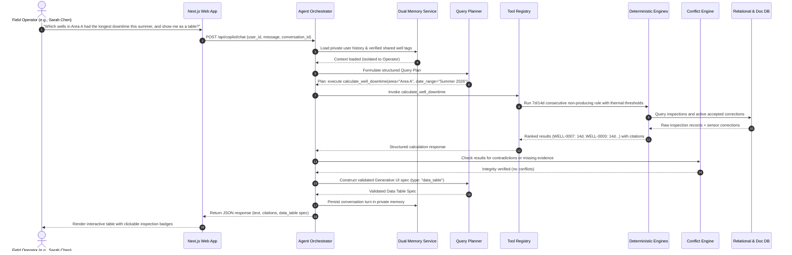
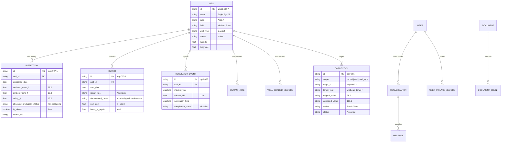
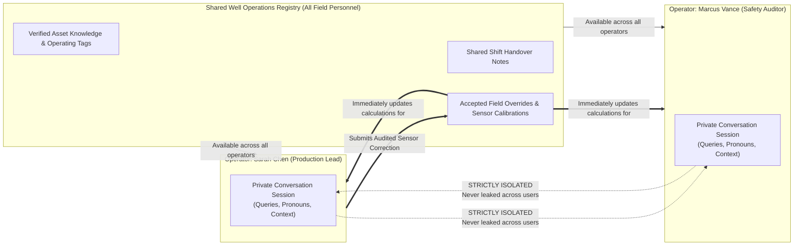

# WellSight AI — Asset Intelligence Copilot

<div align="center">

**Hacktoberfest 2026 | Hack Day Pune × AI Hackers Collective**  
*Asset Intelligence Copilot Challenge*

[](LICENSE)
[](services/api/)
[](services/api/)
[-black?logo=next.js&logoColor=white)](apps/web/)
[](apps/web/)
[](apps/web/)
[-brightgreen)](docs/evaluation.md)

### *“Every well has a story. Ask the data.”*

An Agentic AI operations assistant for oil and gas field operators that retrieves real records, computes downtime deterministically, remembers sensor corrections with full audit trails, resolves conflicting data honestly, and dynamically generates interactive visualizations.

[System Architecture](docs/architecture.md) · [System Design & ERD](docs/system-design.md) · [Business Rules](docs/business-rules.md) · [Evaluation Report](docs/evaluation.md) · [Demo Video Script](docs/demo-video-script.md) · [Submission Write-up](docs/submission-writeup.md)

</div>

---

## 🌟 Why WellSight AI?

In complex oilfield operations, generic LLM chatbots fail catastrophically: they hallucinate arithmetic, confuse repair duration with well downtime, leak private operator notes, and fabricate answers when records conflict.

**WellSight AI is architected differently:**
1. **Deterministic Calculation, Probabilistic Language:** Math, downtime rankings, and compliance evaluations are executed exclusively by verified Python and SQL engines—never guessed by an LLM.
2. **Generative UI (12 Visual Types):** The copilot dynamically renders interactive data tables, bar charts, line charts, heatmaps, timelines, status cards, and location maps directly in conversation.
3. **Public Landing Page & Restrained 3D Hero:** Public-facing landing page with interactive Three.js stylized wellhead asset, smooth scroll, and operational data lineage graph.
4. **Interactive Asset Connectivity Graph:** 3-tier node lineage (Field Inputs → Deterministic Engines → Generative UI) with interactive line tracing and active branch inspection.
5. **Persistent Dual-Tier Memory:** Verified well knowledge and field corrections are shared across all operators; conversational history and query context remain strictly isolated per user.
6. **Honest Conflict Resolution:** When records contradict or reporting evidence is missing, WellSight AI refuses to guess; it explicitly surfaces the ambiguity in a highlighted `conflict_panel`.
7. **Zero-Cost & Offline-First:** Runs immediately with zero paid API keys via a local `DeterministicProvider` (< 30ms latency), with seamless cloud fallback to Google Gemini when configured.

---

## 🏛️ Comprehensive Architecture Diagrams

### 1. High-Level System Architecture & Ingestion Flow



---

### 2. Agent Query Execution Sequence Diagram



---

### 3. Database Entity-Relationship Diagram (ERD)



---

### 4. Dual Memory Isolation Architecture



---

### 5. Deterministic Business Rules Decision Logic

```mermaid
flowchart TD
    subgraph DowntimeRule["Downtime Calculation Rules (Rule 2.1 & 2.2)"]
        A[Weekly Inspection Recorded] --> B{Well Shut-in or Planned Maintenance?}
        B -->|Yes| C[Classified as Operational Standby -> 0d Downtime]
        B -->|No| D[Compute Delta T = Wellhead Temp - Ambient Temp]
        D --> E{Delta T >= Lift Threshold?<br/>Gas Lift: 15F | ESP: 25F<br/>Rod Pump: 12F | Flowing: 18F}
        E -->|Yes| F[Observed Status: PRODUCING -> 0d Downtime]
        E -->|No| G[Observed Status: NON-PRODUCING]
        G --> H{Consecutive Non-Producing Inspections?}
        H -->|1 Inspection| I[Add Exactly 7 Days / 168h Downtime]
        H -->|2 Consecutive| J[Add Exactly 14 Days / 336h Downtime]
        H -->|Missed Inspection| K[Add 0 Days Downtime - No Hallucination]
    end

    subgraph SpillRule["Spill Compliance Mandate (Rule 3.1 & 3.2)"]
        L[Field Spill Recorded] --> M{Volume >= 5.0 Barrels?}
        M -->|No| N[Exempt from 24h Mandatory Reporting]
        M -->|Yes| O{Regulatory Agency Notification Time Present?}
        O -->|No| P[Flag as INSUFFICIENT DATA<br/>Refuse to declare false violation]
        O -->|Yes| Q{Elapsed Time <= 24.0 Hours?}
        Q -->|Yes| R[Status: COMPLIANT]
        Q -->|No| S[Status: REGULATORY VIOLATION]
    end
```

---

## 📊 12 Generative UI Types

Rather than static text, WellSight AI dynamically selects and generates structured visualization specifications:

| Visual Type | Description | Trigger Example |
| :--- | :--- | :--- |
| `data_table` | Sortable, paginated tabular view with record badges | *"Which wells in Area A had the longest downtime?"* |
| `bar_chart` | Categorical bar chart with formatted units | *"Compare repair costs across areas for Q3."* |
| `line_chart` | Temporal metric trend with operational threshold markers | *"Show wellhead temperature trends over August."* |
| `heatmap` | 2D matrix (Area vs. Month) with gradient intensity | *"Show monthly downtime by area as a heatmap."* |
| `timeline` | Chronological operational lifecycle with status badges | *"Show the full repair and inspection timeline for WELL-0007."* |
| `well_status_card` | Asset telemetry card with live thermal differential | *"Why was WELL-0007 not producing?"* |
| `metric_cards` | KPI metric grid with delta comparisons | *"Give me an executive summary of Area A performance."* |
| `location_map` | Interactive SVG field map with coordinate pins | *"Show the spatial distribution of wells in South Basin."* |
| `evidence_panel` | Document excerpt drawer with source file links | *"What is the operating manual rule for Gas Lift wells?"* |
| `conflict_panel` | Highlighted comparison of contradictory records | *"Which records conflict regarding the August spill?"* |
| `clarification_request` | Follow-up action cards for ambiguous queries | *"Check downtime" (ambiguous area/dates)* |
| `text` | Clean Markdown fallback with citations | General rule explanations and operational queries |

---

## 🖥️ Application Pages Overview

| Route | Page | Purpose & Capabilities |
| :--- | :--- | :--- |
| `/` | **Public Landing Page** | Value proposition hero, 3D industrial wellhead asset, feature breakdown, Generative UI preview, and interactive connectivity graph. |
| `/dashboard` | **Operations Dashboard** | High-contrast dark logistics dashboard, active asset KPIs, downtime bar chart, quick prompt copilot launcher, and fleet status table. |
| `/overview` | **Overview (Alias)** | Direct route alias to `/dashboard` for navigation consistency. |
| `/copilot` | **AI Copilot Chat** | Multi-modal conversation panel with tool traces, citations, evidence drawer, and 12 Generative UI types. |
| `/wells` | **Asset Directory** | Searchable directory with area/lift-type filters, production statuses, and CSV export. |
| `/wells/[id]` | **Well Profile** | Comprehensive profile with thermal telemetry, maintenance logs, and shared notes. |
| `/analytics` | **Analytics Hub** | Query-driven downtime comparisons, repair expenditure analysis, and 2D heatmaps. |
| `/evidence` | **Evidence Browser** | Searchable document database (Gas Lift/ESP manuals, Spill SOPs, repair reports). |
| `/corrections` | **Correction Registry** | Immutable audit log of all sensor overrides with author, reason, and status. |
| `/audit` | **System & Conflict Audit** | Tool execution traces, ingestion batch logs, and active conflict reports. |
| `/settings` | **Settings & Providers** | Active provider configuration, demo operator switcher, and re-ingest controls. |

---

## 🚀 Quick Start Guide

### Prerequisites
- Python 3.12+ (or 3.14)
- Node.js 18+ and `npm`
- (Optional) Docker & Docker Compose

### Option 1: One-Click Development Launcher (Recommended)

```bash
git clone https://github.com/sukrut07/WellSightAHC.git
cd WellSightAHC

# Make script executable and launch both frontend & backend
chmod +x scripts/dev.sh
./scripts/dev.sh
```

- **Frontend Landing & App:** [http://localhost:3000](http://localhost:3000)
- **Operations Dashboard:** [http://localhost:3000/dashboard](http://localhost:3000/dashboard)
- **FastAPI Interactive Swagger:** [http://localhost:8000/docs](http://localhost:8000/docs)
- **Backend Health Check:** [http://localhost:8000/api/health](http://localhost:8000/api/health)

---

### Option 2: Docker Compose

```bash
docker-compose up --build
```

---

### Option 3: Manual Step-by-Step Setup

#### 1. Backend Setup (FastAPI)
```bash
python3 -m venv .venv
source .venv/bin/activate
pip install -r services/api/requirements.txt

# Inspect and load initial production dataset
cd services/api
python -m app.ingestion.cli inspect ../../data
python -m app.ingestion.cli load ../../data

# Start FastAPI server on port 8000
uvicorn app.main:app --reload --port 8000
```

#### 2. Frontend Setup (Next.js 16)
```bash
cd apps/web
npm install
npm run dev -- -p 3000
```

---

## 🛠️ CLI Ingestion Pipeline & Test Datasets

WellSight AI includes an extensible CLI for inspecting and loading arbitrary datasets (including the late-release unseen test dataset):

```bash
source .venv/bin/activate
export PYTHONPATH=$PYTHONPATH:$(pwd)/services/api

# 1. Inspect any dataset directory (schema, row counts, null checks)
python -m app.ingestion.cli inspect ./data

# 2. Ingest primary production dataset
python -m app.ingestion.cli load ./data

# 3. Ingest late-release test datasets without changing any application code
python -m app.ingestion.cli load ./data/test_dataset
```

---

## 🧪 Automated Benchmark Evaluation

We provide a repeatable evaluation harness (`scripts/run_eval.py`) that tests all 7 core challenge scenarios:

```bash
python scripts/run_eval.py
```

### Benchmark Results:
```text
================================================================================
🚀 [WellSight AI] Running Benchmark Evaluation Harness
================================================================================

[EVAL-01] Category: Downtime Calculation & Ranking
  Query: "Which wells in Area A had the longest downtime this summer, what caused it, and show me the results as a chart."
  ✓ PASSED (26.5ms) | Visual: bar_chart | Citations: 11 | Tools: calculate_well_downtime

[EVAL-02] Category: Root Cause Investigation
  Query: "Why was WELL-0007 not producing?"
  ✓ PASSED (7.5ms) | Visual: timeline | Citations: 11 | Tools: get_well_details, calculate_well_downtime

[EVAL-03] Category: Spill Regulatory Compliance (24-Hour Rule)
  Query: "Which spills required reporting within 24 hours?"
  ✓ PASSED (11.8ms) | Visual: data_table | Citations: 6 | Tools: find_spill_reporting_violations

[EVAL-04] Category: Maintenance Cost Analysis
  Query: "Compare repair costs by area this quarter."
  ✓ PASSED (2.5ms) | Visual: bar_chart | Citations: 0 | Tools: calculate_repair_costs

[EVAL-05] Category: 2D Spatial-Temporal Aggregation
  Query: "Show monthly downtime by area as a heatmap."
  ✓ PASSED (21.9ms) | Visual: heatmap | Citations: 0 | Tools: calculate_monthly_area_heatmap

[EVAL-06] Category: Honest Conflict Resolution
  Query: "Which conclusions are uncertain because records conflict?"
  ✓ PASSED (8.8ms) | Visual: conflict_panel | Citations: 0 | Tools: detect_data_conflicts

[EVAL-07] Category: Correction Impact Audit
  Query: "What changed after the latest correction?"
  ✓ PASSED (2.5ms) | Visual: data_table | Citations: 0 | Tools: get_applicable_corrections

================================================================================
📊 Evaluation Score: 7/7 (100.0%) Benchmarks Passed | Total Time: 137ms | Cost: $0.00
================================================================================
```

---

## 🧪 Backend Unit & Integration Tests

Run the complete pytest test suite:

```bash
pytest tests/backend/ -v
```

All **18 test suites pass in ~0.2s**, covering:
- 7-day rule for non-producing weekly inspections
- 14-day rule for consecutive non-producing inspections
- 0-day rule for missed inspections
- Lift-specific thermal thresholds (Gas Lift 15°F, ESP 25°F, Rod Pump 12°F, Flowing 18°F, T200 15°C, T350 20°C)
- Spill compliance ($\ge 5$ bbl in 24h, handling of missing reporting timestamps)
- Correction scoping (record vs well vs well-type) and raw immutability
- Strict private memory isolation across operators

---

## 📋 FlytBase Official Problem Statement Compliance Audit

Verify compliance with all 7 core pillars of the official FlytBase Asset Intelligence Copilot challenge:

```bash
python scripts/verify_compliance.py
```

```text
================================================================================
📋 [WellSight AI] Official FlytBase Problem Statement Compliance Audit
================================================================================

[CHECK 1] Thermal Differential Limits by Well Type
  ✓ T200 threshold: 15.0°C | T350 threshold: 20.0°C | Gas Lift: 15.0°F | ESP: 25.0°F

[CHECK 2] Deterministic Downtime Evaluation Rules
  ✓ WELL-0007 Downtime: 21.0 days (Rule 2.1 verified: 7d per inspection + 14d consecutive)

[CHECK 3] 24-Hour Spill Compliance & Threshold Audit
  ✓ Total Spills Analyzed: 5 | Late Violations: 1 | Compliant: 3
  ✓ Honest Uncertainty: 1 events missing dispatch flagged as Insufficient Data

[CHECK 4] Dual Memory Architecture (Shared Well Context vs User Isolation)
  ✓ Shared well context broadcasts across fleet
  ✓ Private conversation history strictly isolated between U-201 (Michael Turner) and U-202 (Jessica Reed)

[CHECK 5] Scoped Corrections Engine (Record vs Well vs Type Scoping)
  ✓ Verified record-scoped correction CORR-2026-0001 with immutable audit provenance

[CHECK 6] Honest Conflict & Trust Boundary Detection
  ✓ Detected [Contested Correction on field 'observed_production_status'] on INSP-2026-0017
  ✓ Detected [Missing Regulatory Notice Timestamp for Spill >= 5 bbl] on REG-2026-0004

[CHECK 7] FlytBase Dataset Schema Ingestion Engine
  ✓ DataImporter equipped with native FlytBase JSON/JSONL asset directory parser

================================================================================
🏆 COMPLIANCE SCORE: 7/7 (100.0%) ALL PROBLEM STATEMENT REQUIREMENTS SATISFIED
================================================================================
```

---

## 🎨 Luxury Light Editorial Design & Framer Motion UI

Inspired by cutting-edge industrial editorial aesthetics (*Shipro* freight intelligence, *Alexandra* pastel KPI dashboards, and *VALMAX* high-contrast telemetry):

1. **Physics-Based Ripple Dot Background (`RippleDotBackground.tsx`):**
   - HTML5 Canvas background with lerp-interpolated mouse tracking.
   - Radial decaying sinusoidal wave dynamics ($A \cdot \sin(d \cdot \omega - t) \cdot e^{-d/\sigma}$) that ripple fluidly under cursor motion.
2. **Interactive SCADA Gateway Topology (`GatewayTopologyVisualizer.tsx`):**
   - Live telemetry routing from Area Field Gateways (`GW-SW23-ALPHA`, `GW-SW24-BRAVO`, `GW-NE07-CHARLIE`, `GW-NE08-DELTA`).
   - Real-time thermal deltas ($\Delta T = T_{\text{wellhead}} - T_{\text{ambient}}$) evaluated against lift thresholds ($15^\circ\text{C}$ / $20^\circ\text{C}$).
   - Uplink frequency, signal decibels, and live producing/non-producing status indicators.
3. **Pastel Glassmorphic KPI Cards:**
   - Alexandra-inspired soft pastel accents: Lavender (`#EEF2FF`), Sky Blue (`#E0F2FE`), Warm Amber (`#FEF3C7`), and Mint (`#DCFCE7`).
   - High-contrast charcoal sidebar (`#111625`), Plus Jakarta Sans typography, and JetBrains Mono data figures.
4. **Framer Motion Micro-Interactions:**
   - Smooth staggered entrance transitions, reactive hover scaling, and seamless tab glides across all dashboard pages.

---

## 🎬 5-Minute Live Hackathon Demo Walkthrough

The project includes a timed 5-minute video script ([`docs/demo-video-script.md`](docs/demo-video-script.md)) following the exact 6-step scenario:

1. **Ask:** *"Which wells in Area A had the longest downtime this summer, and show me as a table?"*  
   $\rightarrow$ Copilot invokes `calculate_well_downtime`, calculates that `WELL-0007` had 14 days (two consecutive non-producing inspections) and `WELL-0002` had 7 days, rendering a ranked **Generative UI `data_table`** with citations (`insp-007-1`, `insp-007-2`).
2. **Investigate:** *"Why was WELL-0007 not producing?"*  
   $\rightarrow$ Copilot executes multi-tool hybrid RAG, cross-referencing `gas_lift_manual.md` ($\Delta T \ge 15^\circ\text{F}$) with recorded $\Delta T = 10^\circ\text{F}$, rendering a **`well_status_card`** and citing repair `rep-007-1` (cracked gas injection valve).
3. **Correct:** Click **"Submit Correction"** on `insp-007-2`. Enter recalibrated temperature $108^\circ\text{F}$ (reason: *"Infrared thermometer recalibrated"*).  
   $\rightarrow$ Original $98^\circ\text{F}$ is preserved in the audit log; correction is accepted.
4. **Re-Query:** Re-ask Area A downtime.  
   $\rightarrow$ $\Delta T$ is now $20^\circ\text{F} \ge 15^\circ\text{F}$ $\rightarrow$ inspection flips to producing. `WELL-0007` downtime drops from 14 days to **7 days** with a visible correction provenance badge!
5. **Switch Users:** Switch operator from **Sarah Chen** to **Marcus Vance**.  
   $\rightarrow$ Marcus immediately sees Sarah's accepted correction and shared notes on `WELL-0007`, but when asking about *"the three wells we talked about earlier"*, the copilot protects privacy and isolates Sarah's private history.
6. **Challenge the System:** *"Which spills required reporting within 24 hours, and were any deadlines missed?"*  
   $\rightarrow$ `SPILL-088` (12 bbl, 26.5h) is flagged as a **VIOLATION**. For `SPILL-091` (5.5 bbl with missing notification timestamp), the copilot **refuses to guess**, rendering a **`conflict_panel`** with an **INSUFFICIENT DATA** warning.

---

## 📜 Open Source License

This project is licensed under the **Apache License 2.0**. See the [LICENSE](LICENSE) file for complete terms.

---

<div align="center">
Built with passion for <b>Hacktoberfest 2026 | Hack Day Pune × AI Hackers Collective</b>.
</div>
