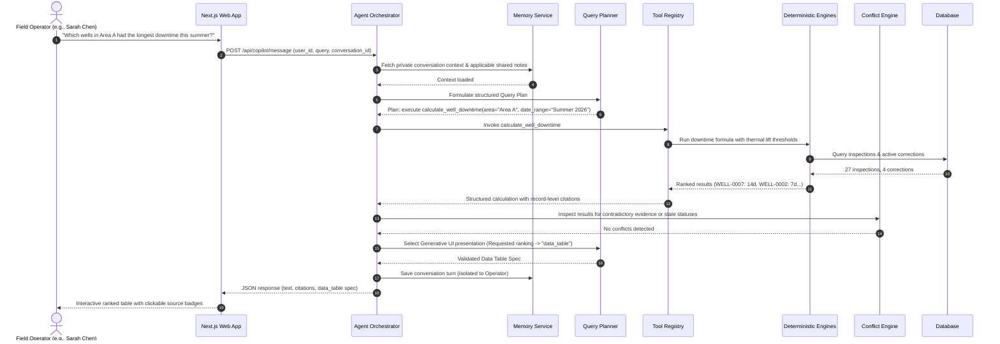
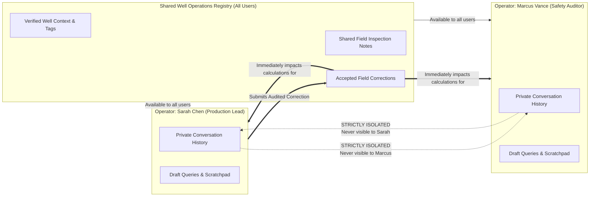

# WellSight AI — System Architecture

**Asset Intelligence Copilot · Hacktoberfest 2026**  
*Tagline: Every well has a story. Ask the data.*

---

## 1. High-Level Architectural Overview

WellSight AI is engineered as an **Agentic AI operations copilot** that decouples question planning and natural-language reasoning from deterministic analytics and database operations.

Rather than relying on Large Language Models for arithmetic calculations or unstructured vector search alone, WellSight AI employs a **Hybrid Tool & Reasoning Orchestration Architecture**:
- **Deterministic Analytics Engine:** Executes verified business rules (e.g., 7-day non-producing weekly inspections, thermal differential lift thresholds, spill deadline calculations) via Python and SQL.
- **Hybrid Retrieval System:** Combines exact relational SQL filtering with semantic document chunk retrieval (SOPs, operating manuals, field repair reports).
- **Persistent Dual Memory:** Enforces a clean boundary between shared well knowledge visible to all field personnel and user-private conversational memory.
- **Generative UI Pipeline:** Generates strictly typed, server-validated visualization specifications (12 distinct visual types) rendered natively by Next.js components.

```mermaid
flowchart TD
    subgraph Client["Frontend Layer (Next.js 16 + TypeScript)"]
        UI[Copilot Chat Interface]
        GenUI[Generative UI Renderer\n(12 Visual Types)]
        EvidenceDrawer[Evidence & Citation Drawer]
        CorrectionModal[Correction Submission Form]
        UserSwitcher[Operator Context Switcher]
    end

    subgraph API["FastAPI Backend (Python 3.12 / 3.14)"]
        Router[API Gateway & Router]
        Orchestrator[Agent Orchestrator]
        Planner[Validated Query Planner]
        ToolRegistry[Typed Tool Registry\n(16 Analytical & Retrieval Tools)]
        ConflictEngine[Conflict Detection Engine]
    end

    subgraph Intelligence["LLM & Analytical Providers"]
        ProviderInterface[Provider Abstraction]
        Gemini[Google Gemini 2.5/Flash]
        Deterministic[Deterministic Offline Provider\n(Zero-Cost / High-Speed)]
    end

    subgraph CoreEngines["Deterministic Core Engines"]
        DowntimeEngine[Downtime Engine\n(7d / 14d / Thermal Thresholds)]
        SpillEngine[Spill Compliance Engine\n(5 bbl / 24h Deadline)]
        MemoryService[Dual Memory Service\n(Shared vs Private)]
        RetrievalService[Hybrid RAG & Chunk Matcher]
    end

    subgraph Storage["Persistence Layer (PostgreSQL + pgvector / SQLite)"]
        DB[(Relational DB\nWells, Inspections, Repairs, Events)]
        Docs[(Document Chunks & Embeddings\nManuals, SOPs, Reports)]
        Corrections[(Immutable Raw Records\n& Scoped Correction Audit Log)]
        Memory[(Shared Well Context\n& Private Chat History)]
    end

    UI -->|Natural Language Query + User ID| Router
    Router --> Orchestrator
    Orchestrator --> MemoryService
    MemoryService -->|Inject Context| Orchestrator
    Orchestrator --> ProviderInterface
    ProviderInterface --> Gemini
    ProviderInterface --> Deterministic
    ProviderInterface -->|Query Plan| ToolRegistry
    ToolRegistry --> CoreEngines
    CoreEngines --> Storage
    CoreEngines --> ConflictEngine
    ConflictEngine --> Orchestrator
    Orchestrator -->|Answer + Citations + GenUI Spec| Router
    Router --> GenUI
    Router --> EvidenceDrawer
    CorrectionModal -->|Submit Scoped Override| Router
```

---

## 2. Agent Orchestration & Execution Lifecycle

Every user query flows through a deterministic, bounded execution loop:



---

## 3. Generative UI Architecture

WellSight AI enforces **type-safe generative presentation**:
1. **Server-Owned Data:** The LLM selects the visualization type and presentation metadata (title, axes, descriptions), but the underlying data values are generated exclusively by deterministic server-side tools.
2. **Discriminated Union Validation:** The backend validates every visual payload against a strict Pydantic model (`VisualSpec`). The frontend validates against an identical TypeScript discriminated union before mounting any React component.
3. **Zero Arbitrary Execution:** No arbitrary JSX, HTML, JavaScript, or untrusted code is ever received or executed from model outputs.

### Supported Generative UI Types

| Type | Description | Primary Use Case |
| :--- | :--- | :--- |
| `data_table` | Sortable, paginated, columnar view with record links | Well rankings, inspection logs, repair ledgers |
| `bar_chart` | Categorical comparative chart with value formatting | Downtime comparisons, repair costs by area |
| `line_chart` | Temporal trend visualization with threshold lines | Pressure drops, fluid rates, temperature differentials |
| `heatmap` | 2D matrix (e.g., Area vs Month) with gradient cells | Operational downtime hot-spots across fields |
| `timeline` | Sequential event timeline with status badges | Well incident history, workover & repair lifecycle |
| `well_status_card` | Compact asset profile with live telemetry & status | Single well health check, operating parameters |
| `metric_cards` | KPI card grid with delta indicators and subtext | Executive area summaries, total production impact |
| `location_map` | Interactive SVG field map with coordinate pins | Wellhead geographic positioning, spatial clusters |
| `evidence_panel` | Document excerpt drawer with source file references | Manual citations, SOP rule extracts, repair notes |
| `conflict_panel` | Highlighted comparison of contradictory records | Unresolved corrections, disputed spill dates |
| `clarification_request` | Interactive follow-up options for ambiguous queries | Disambiguating well IDs or date ranges |
| `text` | Clean Markdown fallback with citations | General operational inquiries, rule explanations |

---

## 4. Persistent Memory Isolation Boundary

WellSight AI strictly separates **Shared Well Knowledge** from **Private User History**:



- **Shared Memory:** Contains field observations, verified operational tags, and accepted data corrections. Changes to shared memory require provenance tracking (author, timestamp, reason, target) and are immediately visible to all operators.
- **Private Memory:** Contains conversational history, user-specific contextual pronouns (e.g., *"the three wells we investigated this morning"*), and unshared query logs. Private memory is strictly scoped by `user_id` and is never leaked across operators.

---

## 5. Persistent Correction & Audit Trail Architecture

```mermaid
flowchart TD
    Raw[Raw Immutable Record\ne.g., Inspection #4: Wellhead Temp = 98°F]
    Submission[Operator Submits Correction\ne.g., Thermometer recalibrated -> Corrected Temp = 108°F]
    
    subgraph AuditTrail["Immutable Correction Audit Log"]
        CorrRecord[Correction #101\nScope: Record-level\nTarget: Inspection #4\nOriginal: 98°F | Corrected: 108°F\nAuthor: Sarah Chen | Status: ACCEPTED]
    end

    Submission --> CorrRecord
    Raw -.->|Original preserved untouched| CorrRecord

    subgraph RuntimeEngine["Query & Calculation Engine"]
        Query[Operator Query: Calculate Downtime]
        ApplyCorr{Active Accepted\nCorrection Exists?}
        Query --> ApplyCorr
        ApplyCorr -->|Yes| Override[Apply Corrected Value: 108°F]
        ApplyCorr -->|No| UseRaw[Use Original Raw Value: 98°F]
        Override --> Formula[Evaluate Lift Threshold: 108°F - 80°F = 28°F >= 15°F -> PRODUCING]
        UseRaw --> Formula
    end

    CorrRecord --> ApplyCorr
```

- **Immutability:** Original imported records are never overwritten or deleted.
- **Scoping Hierarchy:** Corrections can be scoped to a single `record`, an entire `well`, or a `well_type`.
- **Conflict Handling:** Contradictory corrections (e.g., two operators submitting conflicting temperatures for the same inspection) trigger an automatic conflict alert rather than silent resolution.
