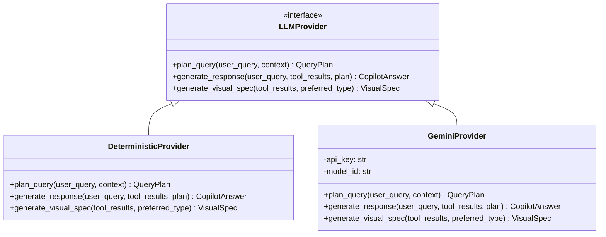
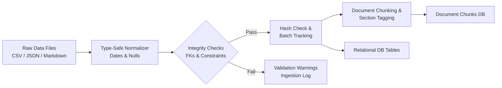

# WellSight AI — System Design & Data Specification

**Asset Intelligence Copilot · Hacktoberfest 2026**  
*Tagline: Every well has a story. Ask the data.*

---

## 1. Database Schema & Data Models

WellSight AI is built on a normalized relational schema with support for vector embeddings (`pgvector` in PostgreSQL, with full SQLite fallback for zero-dependency local testing).

```mermaid
erDiagram
    WELL ||--o{ INSPECTION : "has weekly"
    WELL ||--o{ REPAIR : "receives"
    WELL ||--o{ REGULATOR_EVENT : "reports"
    WELL ||--o{ HUMAN_NOTE : "has operator"
    WELL ||--o{ WELL_SHARED_MEMORY : "accumulates"
    WELL ||--o{ CORRECTION : "targets"
    USER ||--o{ CONVERSATION : "owns private"
    USER ||--o{ USER_PRIVATE_MEMORY : "stores"
    CONVERSATION ||--o{ MESSAGE : "contains"
    DOCUMENT ||--o{ DOCUMENT_CHUNK : "split into"

    WELL {
        string id PK "e.g., WELL-0007"
        string well_name
        string api_number
        string field_name
        string area "e.g., Area A"
        string lift_type "Gas Lift, ESP, Rod Pump, Flowing"
        string status "active, shut-in, planned-maintenance, abandoned"
        float surface_latitude
        float surface_longitude
        date spud_date
        datetime created_at
    }

    INSPECTION {
        integer id PK
        string well_id FK
        date inspection_date
        float wellhead_temp_f "Measured wellhead temp"
        float ambient_temp_f "Ambient air temp"
        string producing_status "producing, non-producing, shut-in, maintenance"
        string inspector_name
        string notes
        string source_file
        integer import_batch_id
    }

    REPAIR {
        integer id PK
        string well_id FK
        date repair_date
        string component "Valve, Pump, Tubing, Motor"
        string failure_cause
        float cost_usd
        float hours_to_repair "Repair duration (NOT downtime)"
        string technician
        string source_file
    }

    REGULATOR_EVENT {
        integer id PK
        string well_id FK
        datetime incident_time
        string event_type "spill, emissions, flaring"
        float spill_volume_bbl "Barrels spilled"
        datetime notification_time "Time reported to regulator"
        string regulatory_agency "e.g., TX RRC / EPA"
        string reporting_status "compliant, violation, insufficient-data"
        string source_file
    }

    CORRECTION {
        integer id PK
        string scope "record, well, well_type"
        string target_id "Record ID, Well ID, or Lift Type"
        string field_name "e.g., wellhead_temp_f, spill_volume_bbl"
        string original_value "Preserved raw value"
        string corrected_value "Approved new value"
        string author "Operator name"
        string reason "Recalibration, lab retest, typo"
        string status "accepted, pending, contested, superseded"
        datetime created_at
    }

    WELL_SHARED_MEMORY {
        integer id PK
        string well_id FK
        string category "mechanical, geological, operational, safety"
        string key
        string value
        string author
        boolean verified
        datetime created_at
    }

    USER_PRIVATE_MEMORY {
        integer id PK
        string user_id FK
        string conversation_id FK
        string key
        string value
        datetime created_at
    }

    DOCUMENT {
        integer id PK
        string title
        string document_type "manual, sop, report, regulation"
        string source_file
        string version
    }

    DOCUMENT_CHUNK {
        integer id PK
        integer document_id FK
        integer chunk_index
        string section_title
        text chunk_text
        string applicable_well_type
        json metadata_payload
    }
```



---

## 2. Typed Tool Registry Specification

The application implements **16 typed analytical and retrieval tools**. Every tool is callable through standard JSON contracts and returns structured evidence with provenance and error envelopes.

| Tool Name | Parameters | Return Type | Description |
| :--- | :--- | :--- | :--- |
| `get_well_details` | `well_id: str` | `WellDetailResponse` | Returns profile, lift type, area, coordinates, and operating status. |
| `get_inspection_history` | `well_id: str, date_range: str` | `List[InspectionResponse]` | Retrieves weekly thermal readings, producing statuses, and notes. |
| `calculate_well_downtime` | `area: str, date_range: str, limit: int` | `DowntimeRankResponse` | Calculates cumulative downtime based on 7-day weekly non-producing inspections. |
| `compare_well_downtime` | `well_ids: List[str], date_range: str` | `DowntimeComparisonResponse` | Compares downtime side-by-side across specific well identifiers. |
| `get_repair_history` | `well_id: str, date_range: str` | `List[RepairResponse]` | Retrieves mechanical failure causes, costs, and technician work logs. |
| `calculate_repair_costs` | `area: str, date_range: str, group_by: str` | `RepairCostResponse` | Aggregates repair expenditure by area, lift type, or component. |
| `search_manuals` | `query: str, well_type: str` | `List[DocumentChunkResponse]` | Hybrid search over operating manuals for lift thresholds and guidelines. |
| `get_regulator_events` | `well_id: str, date_range: str` | `List[RegulatorEventResponse]` | Returns spills, flaring incidents, and official agency notifications. |
| `find_spill_reporting_violations` | `date_range: str` | `SpillViolationResponse` | Evaluates spills $\ge 5$ bbl against the 24-hour notification deadline. |
| `get_area_performance` | `area: str, date_range: str` | `AreaPerformanceResponse` | Returns aggregate metrics: producing well count, total downtime, costs. |
| `search_human_notes` | `query: str, well_id: str` | `List[HumanNoteResponse]` | Searches unstructured operator logbook notes and field comments. |
| `get_applicable_corrections` | `target_id: str, scope: str` | `List[CorrectionResponse]` | Resolves active, accepted corrections for a record, well, or well-type. |
| `get_shared_well_context` | `well_id: str` | `List[SharedContextResponse]` | Retrieves team-wide shared operational context and verified tags. |
| `get_private_conversation_context` | `user_id: str, conversation_id: str` | `PrivateContextResponse` | Retrieves user-private memory, pronouns, and previous query context. |
| `record_user_correction` | `scope, target_id, field, value, reason` | `CorrectionResult` | Submits a new scoped data override while preserving the raw original. |
| `detect_data_conflicts` | `well_id: str, target_id: str` | `ConflictReport` | Inspects database for contradictory corrections, dates, or missing evidence. |

---

## 3. Provider Abstraction Architecture

WellSight AI guarantees **zero external dependencies** for hackathon evaluation while fully supporting production cloud models:



- **DeterministicProvider (Offline Default):**
  - Instantaneous execution (< 30ms).
  - 100% deterministic query parsing and tool invocation.
  - Zero API keys, zero token fees, zero rate-limit risks.
  - Generates comprehensive evidence citations and typed Generative UI specs.
- **GeminiProvider (Cloud Fallback):**
  - Activated when `GEMINI_API_KEY` is present in the environment.
  - Leverages Google Gemini 2.5/Flash for dynamic natural language formulation and conversational nuance.
  - Gracefully falls back to `DeterministicProvider` if the network times out or the quota is exhausted.

---

## 4. Ingestion Pipeline & Test Dataset Loading

The ingestion framework handles both structured CSV/JSON data and unstructured Markdown/PDF documentation.

### CLI Commands

```bash
# 1. Inspect dataset structure, row counts, and column types
python -m app.ingestion.cli inspect ./data

# 2. Ingest primary production dataset
python -m app.ingestion.cli load ./data

# 3. Load late-release unseen test dataset without touching application code
python -m app.ingestion.cli load ./data/test_dataset
```

### Ingestion Pipeline Flow



- **Batch Tracking:** Every import receives a unique `import_batch_id` and timestamp.
- **Idempotency:** Re-importing existing files detects duplicates by primary key and record hash, preventing corrupted duplicate records.
- **Raw Immutability:** Imported records are marked with their `source_file` and are never altered when users submit corrections.

---

## 5. Security & Trust Architecture

1. **No Untrusted Code Execution:** The LLM cannot execute arbitrary Python, bash, SQL, or client JavaScript.
2. **Parameterized Database Queries:** All database interactions utilize SQLAlchemy ORM with bound parameters, preventing SQL injection.
3. **Prompt Injection Mitigation:** Retrieved documents, SOPs, and user notes are strictly quarantined in data payloads; system instructions are never dynamically modified by retrieved content.
4. **Audit Trail Completeness:** All corrections, data overrides, and tool executions are recorded in the `audit_events` ledger with actor IDs and timestamps.
